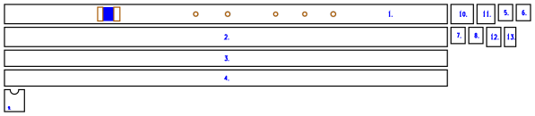
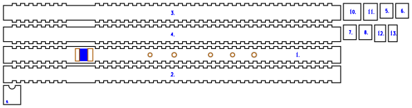

# Square-bore flute

<!-- readme-only -->
**[Read the writeup](https://gernreich.github.io/square-flute/)** ·
**[Turn every build in 3D](https://gernreich.github.io/square-flute/#turn-it-in-3d)**

<!-- page-only **[Read the README](https://github.com/Gernreich/square-flute)** -->

A five-hole minor-pentatonic flute in A4, in the Native American style, rebuilt in 3mm
plywood with a square or rectangular bore. It keeps the **bore area of a 3/4in (19.05mm)
round-bore flute, 285mm²**, so the air column is the same in a section a laser can
build. All closed it sounds A4; opening the holes from the foot up gives C5, D5, E5,
G5 and A5.

Output is millimetre-true — `1 user unit = 1 mm` with a physical `width`/`height` — so
it prints and cuts at real size.

**None of these builds has been cut or played yet.** The holes and the foot come from
an acoustic model, and the foot is cut long to be trimmed to pitch. The author's own
flute of 2017, which has been, is here too, redrawn in A4 at the same bore area and
length as `box-square-3`, and most of its ideas are in every build.

<table>
<tr>
<td align="center"><a href="cut-files/box-square-6-bird-flue/square-flute-A4-box-square-6-bird-flue-sheet1-cut-files.svg"></a></td>
</tr>
<tr>
<td align="center"><sub>box-square-6-bird-flue · the whole flute on one 593 × 141mm sheet</sub></td>
</tr>
</table>

Built for **[LaserMadeMusic](https://www.youtube.com/@LaserMadeMusic)**.

**[The rest of the build files](https://gernreich.github.io/)** — every instrument,
generator and tool, indexed.

**[Download everything as a ZIP](https://github.com/Gernreich/square-flute/archive/refs/heads/main.zip)**

## The builds

The box and the stack each come with the finger holes in 3mm or 6mm of wall. Each of
those four comes as a pair, the same in every part but the one the flue is carved in:
`-bird-flue` (the woodland style) or `-nest-flue` (the plains style), as in
`box-square-3-bird-flue` and `box-square-3-nest-flue`. The 3D view below has a toggle
for it.

| Build | Construction | Bore | Hole wall | Parts | Sheets | Joints |
|---|---|---|---|---|---|---|
| `box-square-3` | finger-jointed box | 16.88 × 16.88mm | 3mm | 12 | 1 | the bird and the cap glued, the rest press-fit |
| `box-square-6` | finger-jointed box | 16.88 × 16.88mm | 6mm | 13 | 1 | the doubler, the bird and the cap glued |
| `stack-rect-3` | laminated stack | 15.83 × 18mm | 3mm | 12 | 1 | every layer and the cap glued |
| `stack-rect-6` | laminated stack | 15.83 × 18mm | 6mm | 13 | 1 | every layer and the cap glued |

- **The box** is four plates, finger-jointed edge to edge: the sides' fingers fill
  notches in the edges of the top and the bottom and run flush to the outside faces, so
  no plate is left outboard of a joint. The plug is four discs pressed into the bore.
- **The stack** is a bottom layer, six bore layers with the bore cut out of them and
  the plug left solid, and the top.
- **The 6mm builds** glue a 3mm doubler over the run of finger holes, so each hole has
  a 6mm chimney, as a wooden flute's wall would give it.

Every build carries the author's mouthpiece cap from the 2017 flute below: a plate
glued over the mouth end, with a half-round notch in its bottom edge, away from the
finger holes. The notch is a 9.59mm circle centred 0.33mm inside the edge, 5.1mm
deep, so it opens through the bottom wall into the slow air chamber.

Every build has the 2017 flute's window and exit hole too: both run **the whole width
of the bore**, with the flue joining them across that same width. And every finger hole
sits in the 2017 flute's **soft engraved depression**, its `ring.png` kept in the
original's proportion to the hole, 1.57 times it across; on a 6mm build the
depressions are on the doubler, where the finger lands. In the box no finger
stands beside either opening, since a full-width opening reaches the inner face of the
bore, which is the floor of every finger notch.

The box is square, the bore that was asked for. The stack cannot be: it is a whole
number of 3mm layers deep, 15 or 18mm, and 16.88 is neither, so it keeps the area and
gives up the square.

Every build is 491–495mm long, the author's two 494.8mm, and all of them fit a 600 × 308mm bed.

## Turn it in 3D

<!-- readme-only -->
Every build turns in 3D on the [published page](https://gernreich.github.io/square-flute/#turn-it-in-3d),
which GitHub does not run: drag to turn it, pull it apart into its parts, or see
through the walls to the plug and the bird.

<!-- page-only <div id="turn3d"></div><script src="viewer.js"></script> -->

## What the model says

**The bore's shape barely matters.** The square and the 15.83 × 18mm rectangle put
every hole within 1.2mm of each other, and even that is the window rather than the
bore: the window is as wide as the bore, so the narrower rectangle has the narrower
window. At one window width the two agree to 0.1mm. Box or stack is a building choice,
not an acoustic one.

**The wall's thickness matters most.** With the holes in 6mm of wall instead of 3mm,
every one of them sits 8.6–10.1mm nearer the window, because a hole's chimney is part of
its length.

**The holes are laid out for the hands.** Five equal 8mm holes land 30, 31, 45 and
18mm apart in 3mm of wall, and 28, 30, 47 and 15mm apart in 6mm; two fingers will not
cover holes 15 or 18mm apart. So the lower hand takes holes 1–3
and the upper hand 4–5, each hand's holes 25mm apart, and each hole is sized to its
note. A bird-flue build and its nest-flue counterpart share a layout:

| Variants | Sound chamber | Hole 1, C5 | Hole 2, D5 | Hole 3, E5 | Hole 4, G5 | Hole 5, A5 |
|---|---|---|---|---|---|---|
| `box-square-3-…` | 354.3mm | 260.2 · ø7.1 | 235.2 · ø8.0 | 210.2 · ø9.9 | 159.4 · ø8.0 | 134.4 · ø6.4 |
| `box-square-6-…` | 352.1mm | 251.6 · ø7.7 | 226.6 · ø8.0 | 201.6 · ø9.2 | 149.3 · ø8.0 | 124.3 · ø6.6 |
| `stack-rect-3-…` | 353.1mm | 259.1 · ø7.1 | 234.1 · ø8.0 | 209.1 · ø9.9 | 158.3 · ø8.0 | 133.3 · ø6.4 |
| `stack-rect-6-…` | 350.9mm | 250.5 · ø7.7 | 225.5 · ø8.0 | 200.5 · ø9.2 | 148.2 · ø8.0 | 123.2 · ø6.6 |

Distances are from the centre of the window, in mm. Hole 1 is nearest the foot. Drawn
to scale at the square bore, mouth on the left:


### The scale as ratios

Each note's frequency against the lowest one, as the just ratio that names the
interval, and the step up from the note below it:

| Note | Interval from A4 | Ratio from A4 | Step from the note below | Just, cents | Tuned to, cents |
|---|---|---|---|---|---|
| A4 | unison | 1:1 | | 0 | 0 |
| C5 | minor third | 6:5 | 6:5, a minor third | 315.6 | 300 |
| D5 | perfect fourth | 4:3 | 10:9, a minor whole tone | 498.0 | 500 |
| E5 | perfect fifth | 3:2 | 9:8, a major whole tone | 702.0 | 700 |
| G5 | minor seventh | 9:5 | 6:5, a minor third | 1017.6 | 1000 |
| A5 | octave | 2:1 | 10:9, a minor whole tone | 1200.0 | 1200 |

The steps run 6:5, 10:9, 9:8, 6:5, 10:9: two minor thirds and three whole tones, and no
semitone anywhere: no two notes are a half step apart. The model tunes to
equal temperament, the last column, so every flute here is designed within 18 cents of
the just ratios: the minor third and the minor seventh sit 15.6 and 17.6 cents flat of
6:5 and 9:5, and the fourth and the fifth are 2 cents off. The minor seventh has two other common just values: 16:9 at 996.1 cents
and the harmonic 7:4 at 968.8.

## Before you cut

**The window's end correction is not measured.** It is the least certain term in the
model, and no built flute has checked it yet. Each 1mm of error in it moves the foot
about 2.3mm. So the sound chamber is cut **15mm long**: trim the foot until the flute
sounds A4 with every hole closed.

**The holes move with it, almost as far.** A 10% error in that correction moves the
foot 2.3mm and every hole 2.1–2.2mm. Trimming the foot puts the fundamental right but
leaves the holes where the model put them, so expect to tune each one. A hole that
plays flat can be opened with a file. A hole that plays sharp cannot be closed up.

**The bore is 3/4in, the size for A4.** [Flutopedia's bore table](https://www.flutopedia.com/bore_diameter.htm)
puts A4 near 3/4in. The design started at 7/8in, which was what was asked for, and moved
to 3/4in so that it sits with most flutes in this key.

**The flue is a fill engrave**, about 1mm deep and the full width of the bore. In the
`-bird-flue` builds it is on the underside of the bottom bird layer, woodland style. In
the `-nest-flue` builds and the 2017 flute, it is on the top plate over the plug, plains
style. The depth is a power
setting, so find it on scrap first.

**File the splitting edge by hand.** The window's far edge, where the air splits, needs
a clean bevel of about 30°, and a laser cuts square, charred edges. File it before
assembly, while the top is still a flat plate on the bench; if the edge goes wrong,
recut the top.

**Cut it in 3mm Baltic birch plywood**, at a 0.13mm kerf. The finger joints are the
ones on the trumpet bores in
[trumpet-elbows-allowed](https://github.com/Gernreich/trumpet-elbows-allowed): Boxes.py's
own, with 6mm fingers and 6mm spaces and no play, so the fit comes from the kerf
compensation alone. The plug discs are drawn 0.12mm over the bore, the mallet fit used
on the [lyre-harp](https://github.com/Gernreich/lyre-harp). Press-fit, then seal every
seam with shellac. The doubler, the bird's layers, every layer of the stack and every mouthpiece
cap are glued.

Run the colours **blue, orange, black**: blue engraves the part numbers and the flue,
orange cuts the holes, slots and windows, and black frees the parts. That is the
sequence every LaserMadeMusic repository uses. Every build also carries a greyscale
image round each finger hole, the depression. It needs an image
engrave that turns grey into depth, such as Grayscale mode in xTool Creative Space.

## Tuning

1. Tie the bird on over the exit hole, its front edge on the window's near edge. It is
   tied rather than glued, so it can be slid to voice the flute.
2. With every hole closed, trim the foot until the flute sounds A4.
3. Open hole 1 and tune C5. The holes are cut to the model's size, so if a note is flat,
   open its hole slightly with a file.
4. Work up the flute in order, since each hole nudges the ones above it.

## Regenerating it

```sh
python3 naf_model.py                          # the holes for every build, printed
python3 naf_model.py --mouth=0.8              # with a different window correction
python3 square_flute.py --no-write            # the generator's checks, writing nothing
python3 square_flute.py --out=cut-files       # the bird-flue builds
python3 plus_flute.py --out=cut-files         # the nest-flue builds
python3 your_flute.py --out=yours/cut-files   # the 2017 flute, at A4
python3 page_assets.py                        # viewer.js and the two plans
```

`naf_model.py` is a transmission-matrix model, the standard way woodwind calculators
predict pitch. It treats the bore as a lossy tube, using the section's area and its
hydraulic radius, which is where a square differs from a circle. Each finger hole is
Keefe's tone hole, open or closed. At the top, the window opens into the bore beside a
short closed stub up to the plug.

`square_flute.py` builds each bird-flue build from what the model asks for and checks it before
writing anything:

- every note within a cent of its target
- every part on the bed
- every hole inside the bore
- enough ply between neighbouring holes, and between a hole and a finger notch
- the fingers flush with the outside faces
- the top in one piece
- every part placed on a sheet

It borrows the stroke font for its part numbers from
[`ribbon_bore.py`](https://github.com/Gernreich/trumpet-elbows-allowed/blob/main/parts/bore/concept/swept-curve/ribbon_bore.py)
in trumpet-elbows-allowed, so it expects that repository cloned beside this one.

`.repro` holds the exact command for every file here.

## Bird flue or nest flue: woodland and plains

Each build comes as a pair, named for the one thing that differs between them: where
the flue is carved. In a `-bird-flue` build it is engraved in the underside of the
bird. In a `-nest-flue` build it is engraved in the **nest**, the top plate's face over
the plug, and the bird is three plain layers.

They are the two traditional places for a Native American flute's flue, and they are
kept as a pair on purpose:

| | Where the flue is carved | Style | Here |
|---|---|---|---|
| `-bird-flue` | the underside of the block, the bird | **woodland** | `box-square-3-bird-flue` … `stack-rect-6-bird-flue` |
| `-nest-flue` | the flute's body, the nest under the bird | **plains**, or prairie | `box-square-3-nest-flue` … `stack-rect-6-nest-flue`, and the 2017 flute |

The two put the airstream at different heights. A flue carved in the bird has the nest's
flat surface as its floor, so the air leaves **just above** the top plate. A flue carved
in the nest has the bird's flat underside as its roof, so the air leaves **just below**
the top plate's surface. Against the splitting edge on the window's far side, that is a
shift of about one flue depth, roughly 1mm, which is one reason the two styles voice
differently. The model does not simulate the jet, so which suits these flutes is for a
test cut to show.

A third traditional way forms the flue with a **spacer plate**: a thin plate with a slot
cut through it, between a flat bird and a flat nest. Its floor is the nest, so the air
leaves above the top plate exactly as from a bird flue; only the making differs. The
depth is the spacer's thickness rather than an engrave, so it is exact and even; the
floor and roof are clean ply faces rather than a charred groove; a different depth is a
different spacer, not a new bird; but it is one more surface to seal, and it wants stock
about 1mm thick, not 3mm. None of the builds here uses one.
[Flutopedia's anatomy of the flute](https://www.flutopedia.com/anatomy.htm) and its
[glossary](https://www.flutopedia.com/glossary.htm) describe all three.

Where the flue is carved moves no hole, so the two of a pair share a hole layout, in the
table above. The bird's layers and the cap are glued, as in the original. Two things
are not taken. The engraved splitting edge charred, so the edge is still filed by hand.
And the original's stepped block was for looks only, so the bird keeps its plain layers.

## The author's flute

The builds above began as a fresh take, worked out without seeing this one. This
flute was designed, cut and played in 2017, and its files are in `yours/original/`
exactly as they were. Measured out of `yours/original/NAF_flatjoints.svg`:

| | |
|---|---|
| Bore | 19.37 wide × 22.44mm deep, 435mm² |
| Sound chamber | 313.25mm from the window's centre to the foot |
| Window | 19.37 × 6.0mm, the whole width of the bore |
| Plug | 11mm, its top engraved as the flue |
| Finger holes | 7.73, 7.87, 7.79, 7.79 and 5.47mm, 213.9, 185.7, 156.9, 109.5 and 78.0mm from the window |

It tried two things the first designs here did not:

- **An engraved splitting edge.** `FluteEdge.png` is a greyscale ramp, black at the
  window and white 9.9mm on, engraved beside the window so the laser would cut the
  bevel itself. **It did not work**, so the edge is filed by hand, as it is in every
  build.
- **A soft engraved depression round each finger hole**, `ring.png`, for the finger
  to find. These worked, cut on a Glowforge, whose 3D engrave reads a grey image as
  depth. On an xTool P2S, Grayscale mode in xTool Creative Space varies the power with
  each pixel's brightness, so the same image should work there too. Set its depth on
  scrap first.

<table>
<tr>
<td align="center"></td>
<td align="center"></td>
</tr>
<tr>
<td align="center"><sub>FluteEdge.png · the bevel, which did not work</sub></td>
<td align="center"><sub>ring.png · the depression</sub></td>
</tr>
</table>

Its flue is in the nest, an engrave over the plug, as in the `-nest-flue` builds.

### Redrawn at A4

`your_flute.py` redraws it in A4, in two builds:

- `yours-flat-A4`: the sides butted between the top and the bottom, and glued.
- `yours-fingers-A4`: finger-jointed top and bottom, with the trumpet bores' joint.

The model hears the original near B♭4, as the last table below shows. The two builds
put it on A4 at the bore of `box-square-3`, the build that shares its 3mm wall and its
finger joints:

- **The same cross-section area**, 285.0mm², the 3/4in round bore's, which every build
  has. The original's proportion of width to depth is kept, so the bore is 15.69 wide
  by 18.17mm deep, not square.
- **The same length, end to end**: the same 354.3mm sound chamber, the window centre in
  the same place, and the same 15mm to trim at the foot, so 494.8mm overall. The slow air
  chamber is 104.0mm instead of the original's 123.5.
- **The holes stay where the original had them**, as fractions of the sound chamber, so
  each moves along by 354.3 / 313.25.

| | Original | Redrawn in A4 | `box-square-3` |
|---|---|---|---|
| Bore | 19.37 × 22.44mm, 435mm² | 15.69 × 18.17mm, 285mm² | 16.88 × 16.88mm, 285mm² |
| Window | 19.37 × 6.0mm | 15.69 × 7.01mm | 16.88 × 7.0mm |
| Sound chamber | 313.3mm | 354.3mm | 354.3mm |
| Overall length | 456.7mm | 494.8mm | 494.8mm |
| Finger holes, from the window | 213.9, 185.7, 156.9, 109.5, 78.0mm | 241.9, 210.0, 177.5, 123.9, 88.2mm | 260.2, 235.2, 210.2, 159.4, 134.4mm |
| Hole diameters | 7.73, 7.87, 7.79, 7.79, 5.47mm | 5.24, 4.66, 4.56, 5.11, 4.87mm | 7.09, 8.00, 9.92, 8.00, 6.44mm |

With the length held, only the window is left to set the fundamental. At
`box-square-3`'s 7mm window the original's hole pattern would put the flute 0.15 cents
flat, so the window is solved to 7.01mm for 440Hz with every hole closed. Then each hole is held where it is and its diameter solved, bottom hole first,
until its note lands on equal temperament against A4 = 440Hz. Every note lands within
0.01 cents. The holes come out smaller than the original's: a narrower bore needs a
smaller hole for the same step.

The builds at the original size were removed at the author's asking; the original's own
files are still in `yours/original/`. The tweaks made in redrawing it:

1. Millimetre-true, in the house cut-order colours, kerf-compensated, with every part
   numbered. The originals are drawn in Inkscape's 1/90in units with no kerf.
2. The plug is four 3mm discs, 12mm instead of 11, as in every build.
3. In the fingers build the top is finger-jointed to the sides, like the bottom, so it
   press-fits instead of being glued. Its joint is the trumpet bores' one, 6mm
   fingers with no play, instead of the original's 10mm fingers.
4. The rings are the original's own image, each kept in the original's proportion to
   its hole, so they shrink with the re-solved holes. The ramp is left out,
   because the engraved bevel did not work.
5. With the edge filed by hand, the top is one piece, as in every build: file the
   edge before assembly.

Beyond the bore, the window and the holes, nothing acoustic is changed. The mouthpiece cap and the block's
layers are glued, as they were. The leather tie is its own file: cut it from leather, not ply.

### What the model hears in the original

At its own size, before any redrawing, and with the holes as the author cut them:

| Holes open | Model | Above the fundamental | Minor pentatonic | Just ratio |
|---|---|---|---|---|
| none | 470Hz, A♯4 +14c | 0c | 0c | 1:1 |
| 1 | 559Hz, C♯5 +15c | 300c | 300c | 6:5, 315.6c |
| 2 | 636Hz, D♯5 +36c | 522c | 500c | 4:3, 498.0c |
| 3 | 718Hz, F5 +48c | 733c | 700c | 3:2, 702.0c |
| 4 | 856Hz, A5 −48c | 1038c | 1000c | 9:5, 1017.6c |
| 5 | 949Hz, A♯5 +31c | 1217c | 1200c | 2:1, 1200c |

The shape of the scale agrees to within 40 cents at every hole, which is the best test
the model has had. Its pitch, near B♭4, rests on the same uncalibrated window term as
everything else here. The 2017 flutes have all been given away, so that term cannot be
measured from one. **The first of these builds to be cut and played will set it**, and
with it the foot of every build here.

## Every cut sheet

Every build, every sheet. Each picture is a display rendering; click it for the cut file.

**`box-square-3-bird-flue`** · finger-jointed box, bore 16.88 × 16.88mm, holes in 3mm of wall, the flue in the bird, woodland · 12 parts on 1 sheet

[](cut-files/box-square-3-bird-flue/square-flute-A4-box-square-3-bird-flue-sheet1-cut-files.svg)

**`box-square-3-nest-flue`** · finger-jointed box, bore 16.88 × 16.88mm, holes in 3mm of wall, the flue in the nest, plains · 12 parts on 1 sheet

[](cut-files/box-square-3-nest-flue/square-flute-A4-box-square-3-nest-flue-sheet1-cut-files.svg)

**`box-square-6-bird-flue`** · finger-jointed box, bore 16.88 × 16.88mm, holes in 6mm of wall, the flue in the bird, woodland · 13 parts on 1 sheet

[](cut-files/box-square-6-bird-flue/square-flute-A4-box-square-6-bird-flue-sheet1-cut-files.svg)

**`box-square-6-nest-flue`** · finger-jointed box, bore 16.88 × 16.88mm, holes in 6mm of wall, the flue in the nest, plains · 13 parts on 1 sheet

[](cut-files/box-square-6-nest-flue/square-flute-A4-box-square-6-nest-flue-sheet1-cut-files.svg)

**`stack-rect-3-bird-flue`** · laminated stack, bore 15.83 × 18.00mm, holes in 3mm of wall, the flue in the bird, woodland · 12 parts on 1 sheet

[](cut-files/stack-rect-3-bird-flue/square-flute-A4-stack-rect-3-bird-flue-sheet1-cut-files.svg)

**`stack-rect-3-nest-flue`** · laminated stack, bore 15.83 × 18.00mm, holes in 3mm of wall, the flue in the nest, plains · 12 parts on 1 sheet

[](cut-files/stack-rect-3-nest-flue/square-flute-A4-stack-rect-3-nest-flue-sheet1-cut-files.svg)

**`stack-rect-6-bird-flue`** · laminated stack, bore 15.83 × 18.00mm, holes in 6mm of wall, the flue in the bird, woodland · 13 parts on 1 sheet

[](cut-files/stack-rect-6-bird-flue/square-flute-A4-stack-rect-6-bird-flue-sheet1-cut-files.svg)

**`stack-rect-6-nest-flue`** · laminated stack, bore 15.83 × 18.00mm, holes in 6mm of wall, the flue in the nest, plains · 13 parts on 1 sheet

[](cut-files/stack-rect-6-nest-flue/square-flute-A4-stack-rect-6-nest-flue-sheet1-cut-files.svg)

**`yours-flat-A4`** · the 2017 flute at A4, butt-jointed and glued · 13 parts on 1 sheet

[](yours/cut-files/flat-A4/your-flute-flat-A4-sheet1-cut-files.svg)

**`yours-fingers-A4`** · the 2017 flute at A4, finger-jointed · 13 parts on 1 sheet

[](yours/cut-files/fingers-A4/your-flute-fingers-A4-sheet1-cut-files.svg)

## Files

| | |
|---|---|
| `cut-files/box-square-3-bird-flue/square-flute-A4-box-square-3-bird-flue-sheet1-cut-files.svg` | box, square bore, 3mm hole wall, bird flue |
| `cut-files/box-square-3-nest-flue/square-flute-A4-box-square-3-nest-flue-sheet1-cut-files.svg` | box, square bore, 3mm hole wall, nest flue |
| `cut-files/box-square-6-bird-flue/square-flute-A4-box-square-6-bird-flue-sheet1-cut-files.svg` | box, square bore, 6mm hole wall, bird flue |
| `cut-files/box-square-6-nest-flue/square-flute-A4-box-square-6-nest-flue-sheet1-cut-files.svg` | box, square bore, 6mm hole wall, nest flue |
| `cut-files/stack-rect-3-bird-flue/square-flute-A4-stack-rect-3-bird-flue-sheet1-cut-files.svg` | stack, 15.83 × 18mm bore, 3mm hole wall, bird flue |
| `cut-files/stack-rect-3-nest-flue/square-flute-A4-stack-rect-3-nest-flue-sheet1-cut-files.svg` | stack, 15.83 × 18mm bore, 3mm hole wall, nest flue |
| `cut-files/stack-rect-6-bird-flue/square-flute-A4-stack-rect-6-bird-flue-sheet1-cut-files.svg` | stack, 15.83 × 18mm bore, 6mm hole wall, bird flue |
| `cut-files/stack-rect-6-nest-flue/square-flute-A4-stack-rect-6-nest-flue-sheet1-cut-files.svg` | stack, 15.83 × 18mm bore, 6mm hole wall, nest flue |
| `previews/` | display renderings of every sheet — **not** cut files |
| `viewer.js` | the 3D view of every build, loaded by the published page |
| `plans/square-flute-A4-holes-3mm-wall.svg` · `plans/square-flute-A4-holes-6mm-wall.svg` | the two hole layouts, to scale — display drawings, **not** cut files |
| `plus_flute.py` | the nest-flue builds |
| `naf_model.py` | the acoustic model |
| `square_flute.py` | the generator, and the bird-flue builds |
| `page_assets.py` | builds `viewer.js` and the plans |
| `yours/original/` | the author's 2017 files, unchanged: `NAF_flatjoints.svg`, `NAF_fingerjoints.svg`, `NativeAmericaStyleFlute.svg`, `AirPlug.svg`, `BubingaAirPlug.svg`, `Block.svg`, `FluteEdge.svg`, `FluteEdge.png`, `HoleWithDepression.svg`, `ring.png`, `LeatherStrip.svg` and `Mouthpiece.svg` |
| `yours/cut-files/flat-A4/your-flute-flat-A4-sheet1-cut-files.svg` | the author's flute at A4, butt-jointed |
| `yours/cut-files/fingers-A4/your-flute-fingers-A4-sheet1-cut-files.svg` | the author's flute at A4, finger-jointed |
| `yours/cut-files/your-flute-leather-tie-cut-files.svg` | its leather tie |
| `yours/previews/` | display renderings of those three — **not** cut files |
| `your_flute.py` | measures the original and redraws it in A4 at `box-square-3`'s bore |
| `README.md` · `index.html` | this writeup and its published page; the markdown is the source |
| `.repro` | the command that draws each shipped file |

Released under [CC0 1.0](LICENSE).
