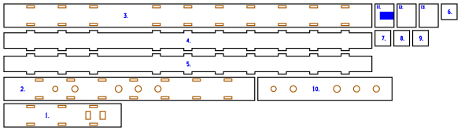

# Square-bore flute

**[See every variant, in 3D](https://gernreich.github.io/square-flute/variants.html)** ·
**[Read the writeup](https://gernreich.github.io/square-flute/)**

A five-hole minor-pentatonic flute in A4, in the Native American style, rebuilt in 3mm
plywood with a square or rectangular bore. It keeps the **bore area of a 7/8in (22.2mm)
round-bore flute, 387mm²**, so the air column is the same in a section a laser can
build. All closed it sounds A4; opening the holes from the foot up gives C5, D5, E5,
G5 and A5.

Output is millimetre-true — `1 user unit = 1 mm` with a physical `width`/`height` — so
it prints and cuts at real size.

**None of these variants has been cut or played yet.** The holes and the foot come
from an acoustic model, and the foot is cut long to be trimmed to pitch. The author's
own flute of 2017, which has been, is here too, with six more variants that borrow
its ideas.

<table>
<tr>
<td align="center"><a href="cut-files/box-square-6/square-flute-A4-box-square-6-sheet1-cut-files.svg"></a></td>
</tr>
<tr>
<td align="center"><sub>box-square-6 · the whole flute on one 592 × 155mm sheet</sub></td>
</tr>
</table>

Built for **[LaserMadeMusic](https://www.youtube.com/@LaserMadeMusic)**.

**[The rest of the build files](https://gernreich.github.io/)** — every instrument,
generator and tool, indexed.

**[Download everything as a ZIP](https://github.com/Gernreich/square-flute/archive/refs/heads/main.zip)**

## The six variants

Three ways to build the bore, each with the finger holes in 3mm or 6mm of wall:

| Variant | Construction | Bore | Hole wall | Parts | Sheets | Joints |
|---|---|---|---|---|---|---|
| `box-square-3` | finger-jointed box | 19.67 × 19.67mm | 3mm | 13 | 1 | the bird and the cap glued, the rest press-fit |
| `box-square-6` | finger-jointed box | 19.67 × 19.67mm | 6mm | 14 | 1 | the doubler, the bird and the cap glued |
| `box-rect-3` | finger-jointed box | 18.43 × 21mm | 3mm | 13 | 1 | the bird and the cap glued, the rest press-fit |
| `box-rect-6` | finger-jointed box | 18.43 × 21mm | 6mm | 14 | 1 | the doubler, the bird and the cap glued |
| `stack-rect-3` | laminated stack | 18.43 × 21mm | 3mm | 14 | 2 | every layer and the cap glued |
| `stack-rect-6` | laminated stack | 18.43 × 21mm | 6mm | 15 | 2 | every layer and the cap glued |

- **The box** is four plates, finger-jointed edge to edge: the sides' fingers fill
  notches in the edges of the top and the bottom and run flush to the outside faces, so
  no plate is left outboard of a joint. The plug is four discs pressed into the bore.
- **The stack** is a bottom layer, seven bore layers with the bore cut out of them and
  the plug left solid, and the top.
- **The 6mm variants** glue a 3mm doubler over the run of finger holes, so each hole has
  a 6mm chimney, as a wooden flute's wall would give it.

Every variant carries the author's mouthpiece cap from the 2017 flute below: a plate
glued over the mouth end, with a half-round notch in its bottom edge, away from the
finger holes. The notch is a 9.59mm circle centred 0.33mm inside the edge, 5.1mm
deep, so it opens through the bottom wall into the slow air chamber.

There is no laminated square bore. A stack is a whole number of 3mm layers deep, 18 or
21mm, and 19.67 is neither, so the stack keeps the area and gives up the square.
`box-rect` is the stack's bore built as a box, so the two constructions can be compared
at one section.

Each of the six is about 469mm long, and each `-plus` variant about 486mm. All of
them fit a 600 × 308mm bed.

## What the model says

**The bore's shape barely matters.** The square and the 18.43 × 21mm rectangle put
every hole within 0.1mm of each other. Box or stack is a building choice, not an
acoustic one.

**The wall's thickness matters most.** With the holes in 6mm of wall instead of 3mm,
every one of them sits 10–16mm nearer the window, because a hole's chimney is part of
its length.

**The holes are laid out for the hands.** Five equal 8mm holes land 27, 30, 46 and 12mm
apart, and two fingers will not cover holes 12mm apart. So the lower hand takes holes
1–3 and the upper hand 4–5, each hand's holes 25mm apart, and each hole is sized to its
note:

| Holes in | Sound chamber | Hole 1, C5 | Hole 2, D5 | Hole 3, E5 | Hole 4, G5 | Hole 5, A5 |
|---|---|---|---|---|---|---|
| 3mm of wall | 328.9mm | 229.7 · ø7.7 | 204.7 · ø8.0 | 179.7 · ø9.2 | 129.4 · ø8.0 | 104.4 · ø6.2 |
| 6mm of wall | 327.2mm | 219.2 · ø8.1 | 194.2 · ø8.0 | 169.2 · ø8.7 | 113.7 · ø8.0 | 88.7 · ø6.8 |

Distances are from the centre of the window, in mm. Hole 1 is nearest the foot.

### The scale as ratios

Each note's frequency against the lowest one, as the just ratio that names the
interval, and the step up from the note below it:

| Note | Interval from A4 | Ratio from A4 | Step from the note below | Just, cents | Tuned to, cents |
|---|---|---|---|---|---|
| A4 | unison | 1:1 | | 0 | 0 |
| C5 | minor third | 6:5 | 6:5, a minor third | 315.6 | 300 |
| D5 | perfect fourth | 4:3 | 10:9, a minor whole tone | 498.0 | 500 |
| E5 | perfect fifth | 3:2 | 9:8, a major whole tone | 702.0 | 700 |
| G5 | minor seventh | 9:5 | 6:5, a minor third | 1017.6 | 1000 |
| A5 | octave | 2:1 | 10:9, a minor whole tone | 1200.0 | 1200 |

The steps run 6:5, 10:9, 9:8, 6:5, 10:9: two minor thirds and three whole tones, and no
semitone anywhere: no two notes are a half step apart. The model tunes to
equal temperament, the last column, so every flute here is designed within 18 cents of
the just ratios: the minor third and the minor seventh sit 15.6 and 17.6 cents flat of
6:5 and 9:5, and the fourth and the fifth are 2 cents off. The minor seventh has two other common just values: 16:9 at 996.1 cents
and the harmonic 7:4 at 968.8.

## Before you cut

**The window's end correction is not measured.** It is the least certain term in the
model, and no built flute has checked it yet. Each 1mm of error in it moves the foot
about 4.5mm, or 2.6mm with a full-width window. So the sound chamber is cut **15mm
long**: trim the foot until the flute sounds A4 with every hole closed.

**The holes move with it, almost as far.** A 10% error in that correction moves the
foot 3.5mm and every hole 2.3–3.0mm. Trimming the foot puts the fundamental right but
leaves the holes where the model put them, so expect to tune each one. A hole that
plays flat can be opened with a file. A hole that plays sharp cannot be closed up.

**7/8in is a large bore for A4.** [Flutopedia's bore table](https://www.flutopedia.com/bore_diameter.htm)
puts A4 nearer 3/4in. This is the bore that was asked for, but most flutes in this key
are narrower.

**The flue is a fill engrave**, about 1mm deep. In the six variants it is 10mm wide, on
the underside of the bottom bird layer. In the `-plus` variants and the 2017 flute, it is
on the top plate over the plug, the full width of the bore. The depth is a power
setting, so find it on scrap first.

**File the splitting edge by hand.** The window's far edge, where the air splits, needs
a clean bevel of about 30°, and a laser cuts square, charred edges. The top is cut as a
short head plate and a long body plate, so a spoilt edge costs only the short one.

**Cut it in 3mm Baltic birch plywood**, at a 0.13mm kerf. The finger joints are the
ones on the trumpet bores in
[trumpet-elbows-allowed](https://github.com/Gernreich/trumpet-elbows-allowed): Boxes.py's
own, with 6mm fingers and 6mm spaces and no play, so the fit comes from the kerf
compensation alone. The plug discs are drawn 0.12mm over the bore, the mallet fit used
on the [lyre-harp](https://github.com/Gernreich/lyre-harp). Press-fit, then seal every
seam with shellac. The doubler, the bird's layers, every layer of the stack and every mouthpiece
cap are glued.

Run the colours **blue, orange, black**: blue engraves the part numbers and the flue,
orange cuts the holes, slots and windows, and black frees the parts. That is the
sequence every LaserMadeMusic repository uses. The `-plus` variants and the 2017 flute
also carry a greyscale image round each finger hole, the depression. It needs an image
engrave that turns grey into depth, such as Grayscale mode in xTool Creative Space.

## Tuning

1. Tie the bird on over the exit hole, its front edge on the window's near edge. It is
   tied rather than glued, so it can be slid to voice the flute.
2. With every hole closed, trim the foot until the flute sounds A4.
3. Open hole 1 and tune C5. The holes are cut to the model's size, so if a note is flat,
   open its hole slightly with a file.
4. Work up the flute in order, since each hole nudges the ones above it.

## Regenerating it

```sh
python3 naf_model.py                          # the holes for every variant, printed
python3 naf_model.py --mouth=0.8              # with a different window correction
python3 square_flute.py --no-write            # the generator's checks, writing nothing
python3 square_flute.py --out=cut-files       # every variant into cut-files/<variant>/
python3 plus_flute.py --out=cut-files         # the -plus variants
python3 your_flute.py --out=yours/cut-files   # the 2017 flute, redrawn
python3 compare_page.py --standalone variants.html
```

`naf_model.py` is a transmission-matrix model, the standard way woodwind calculators
predict pitch. It treats the bore as a lossy tube, using the section's area and its
hydraulic radius, which is where a square differs from a circle. Each finger hole is
Keefe's tone hole, open or closed. At the top, the window opens into the bore beside a
short closed stub up to the plug.

`square_flute.py` builds each variant from what the model asks for and checks it before
writing anything:

- every note within a cent of its target
- every part on the bed
- every hole inside the bore
- enough ply between neighbouring holes, and between a hole and a finger notch
- the fingers flush with the outside faces
- the joint in the top clear of the window and the top hole
- every part placed on a sheet

It borrows the stroke font for its part numbers from
[`ribbon_bore.py`](https://github.com/Gernreich/trumpet-elbows-allowed/blob/main/parts/bore/concept/swept-curve/ribbon_bore.py)
in trumpet-elbows-allowed, so it expects that repository cloned beside this one.

`.repro` holds the exact command for every file here.

## The -plus variants

Each of the six again, with three more ideas from the author's flute below, beyond the
mouthpiece cap that every variant has:

1. A window **the whole width of the bore**, rather than 10mm of it.
2. An exit hole the whole width too, with **the flue engraved in the nest**, over the
   plug, rather than in the bird. The bird is then three plain layers.
3. **A soft engraved depression** round every finger hole, the original's own image,
   1.57 times the hole across. On a 6mm variant it is on the doubler, where the finger
   lands.

A wider window has a smaller end correction, so the model puts the foot 16.5–18mm
further down, and every hole moves with it:

| Variant | Sound chamber | Hole 1 | Hole 2 | Hole 3 | Hole 4 | Hole 5 |
|---|---|---|---|---|---|---|
| `box-square-3-plus` | 346.9mm | 245.9 · ø7.6 | 220.9 · ø8.0 | 195.9 · ø9.4 | 143.0 · ø8.0 | 118.0 · ø6.4 |
| `box-square-6-plus` | 345.2mm | 235.3 · ø8.0 | 210.3 · ø8.0 | 185.3 · ø8.9 | 126.4 · ø8.0 | 101.4 · ø7.0 |
| `box-rect-3-plus`, `stack-rect-3-plus` | 345.4mm | 244.5 · ø7.6 | 219.5 · ø8.0 | 194.5 · ø9.4 | 141.8 · ø8.0 | 116.8 · ø6.4 |
| `box-rect-6-plus`, `stack-rect-6-plus` | 343.7mm | 233.9 · ø8.1 | 208.9 · ø8.0 | 183.9 · ø8.9 | 125.3 · ø8.0 | 100.3 · ø7.0 |

Here the square and the rectangle differ by 1.5mm, where the six agree to 0.1. That is
the window, not the bore: it is as wide as the bore, so the narrower rectangle has the
narrower window.

In the box, a full-width opening reaches the inner faces of the bore, which is the
floor of every finger notch, so no finger stands beside the exit hole or the window. The cap and the
bird's layers are glued, as in the original. Two things are not taken. The engraved
splitting edge charred, so the edge is still filed by hand and the top still split. And
the original's stepped block was for looks only, so the bird keeps its plain layers.

## The author's flute

The six variants above are a fresh take, worked out without seeing this one. This
flute was designed, cut and played in 2017, and its files are in `yours/original/`
exactly as they were. Measured out of `yours/original/NAF_flatjoints.svg`:

| | |
|---|---|
| Bore | 19.37 wide × 22.44mm deep, 435mm² |
| Sound chamber | 313.25mm from the window's centre to the foot |
| Window | 19.37 × 6.0mm, the whole width of the bore |
| Plug | 11mm, its top engraved as the flue |
| Finger holes | 7.73, 7.87, 7.79, 7.79 and 5.47mm, 213.9, 185.7, 156.9, 109.5 and 78.0mm from the window |

It tried two things the six variants do not:

- **An engraved splitting edge.** `FluteEdge.png` is a greyscale ramp, black at the
  window and white 9.9mm on, engraved beside the window so the laser would cut the
  bevel itself. **It did not work**, so the edge is filed by hand, as it is in the six
  variants.
- **A soft engraved depression round each finger hole**, `ring.png`, for the finger
  to find. These worked, cut on a Glowforge, whose 3D engrave reads a grey image as
  depth. On an xTool P2S, Grayscale mode in xTool Creative Space varies the power with
  each pixel's brightness, so the same image should work there too. Set its depth on
  scrap first.

<table>
<tr>
<td align="center"></td>
<td align="center"></td>
</tr>
<tr>
<td align="center"><sub>FluteEdge.png · the bevel, which did not work</sub></td>
<td align="center"><sub>ring.png · the depression</sub></td>
</tr>
</table>

Its flue is the six variants' idea on the other face: an engrave over the plug, in the
nest rather than in the bird.

### Redrawn at A4

`your_flute.py` scales it to A4 and redraws it in two builds:

- `yours-flat-A4`: the sides butted between the top and the bottom, and glued.
- `yours-fingers-A4`: finger-jointed top and bottom, with the trumpet bores' joint.

The model hears the original near B♭4, below. To put it on A4, every dimension that sets
the pitch is multiplied by one factor, **1.0705**, solved so the model gives 440.00Hz:
the bore, the window, each hole's diameter, depression and distance from the window, and
the sound chamber. What ply fixes does not scale: the 3mm wall, the plug's four discs,
the slow air chamber, the exit hole, the cap's notch and the stepped block.

| | Original | At A4 |
|---|---|---|
| Bore | 19.37 × 22.44mm, 435mm² | 20.74 × 24.02mm, 498mm² |
| Window | 19.37 × 6.0mm | 20.74 × 6.4mm |
| Sound chamber | 313.3mm | 335.3mm |
| Overall length | 456.7mm | 479.0mm |
| Finger holes, from the window | 213.9, 185.7, 156.9, 109.5, 78.0mm | 228.9, 198.8, 168.0, 117.2, 83.5mm |
| Hole diameters | 7.73, 7.87, 7.79, 7.79, 5.47mm | 8.27, 8.42, 8.34, 8.34, 5.86mm |

The scale's shape does not come through exactly. The wall stays 3mm while the holes
grow, so each hole acts a little larger, and the intervals widen by 4 to 12 cents. The
model puts the notes at C5 +4, D5 +27, E5 +39, G5 +47 and A5 +29 cents. A hole that
plays sharp cannot be filed back, so tune these with tape over part of the hole, or
have the holes re-solved to equal temperament at this size.

The builds at the original size were removed at the author's asking; the original's own
files are still in `yours/original/`. The tweaks made in redrawing it:

1. Millimetre-true, in the house cut-order colours, kerf-compensated, with every part
   numbered. The originals are drawn in Inkscape's 1/90in units with no kerf.
2. The plug is four 3mm discs, 12mm instead of 11. The exit hole moves 1mm toward the
   mouth to make room.
3. In the fingers build the top is finger-jointed to the sides, like the bottom, so it
   press-fits instead of being glued. Its joint is the trumpet bores' one, 6mm
   fingers with no play, instead of the original's 10mm fingers.
4. The rings are the original's own image, embedded at its original size. The ramp
   is left out, because the engraved bevel did not work.
5. With the edge filed by hand, the top is cut as a short head plate and a long body
   plate, butted 20mm past the window, as in the six variants. A spoilt edge then
   costs only the short plate.

Beyond the scaling, nothing acoustic is changed. The mouthpiece cap and the block's
layers are glued, as they were. The leather tie is its own file: cut it from leather, not ply.

### What the model hears in it

| Holes open | Model | Above the fundamental | Minor pentatonic | Just ratio |
|---|---|---|---|---|
| none | 470Hz, A♯4 +14c | 0c | 0c | 1:1 |
| 1 | 559Hz, C♯5 +15c | 300c | 300c | 6:5, 315.6c |
| 2 | 636Hz, D♯5 +36c | 522c | 500c | 4:3, 498.0c |
| 3 | 718Hz, F5 +48c | 733c | 700c | 3:2, 702.0c |
| 4 | 856Hz, A5 −48c | 1038c | 1000c | 9:5, 1017.6c |
| 5 | 949Hz, A♯5 +31c | 1217c | 1200c | 2:1, 1200c |

The shape of the scale agrees to within 40 cents at every hole, which is the best test
the model has had. Its pitch, near B♭4, rests on the same uncalibrated window term as
everything else here. The 2017 flutes have all been given away, so that term cannot be
measured from one. **The first of these builds to be cut and played will set it**, and
with it the foot of every build here.

## Files

| | |
|---|---|
| `cut-files/box-square-3/square-flute-A4-box-square-3-sheet1-cut-files.svg` | box, square bore, 3mm hole wall |
| `cut-files/box-square-6/square-flute-A4-box-square-6-sheet1-cut-files.svg` | box, square bore, 6mm hole wall |
| `cut-files/box-rect-3/square-flute-A4-box-rect-3-sheet1-cut-files.svg` | box, 18.43 × 21mm bore, 3mm hole wall |
| `cut-files/box-rect-6/square-flute-A4-box-rect-6-sheet1-cut-files.svg` | box, 18.43 × 21mm bore, 6mm hole wall |
| `cut-files/stack-rect-3/square-flute-A4-stack-rect-3-sheet1-cut-files.svg` | stack, 3mm hole wall, sheet 1 of 2 |
| `cut-files/stack-rect-3/square-flute-A4-stack-rect-3-sheet2-cut-files.svg` | stack, 3mm hole wall, sheet 2 of 2 |
| `cut-files/stack-rect-6/square-flute-A4-stack-rect-6-sheet1-cut-files.svg` | stack, 6mm hole wall, sheet 1 of 2 |
| `cut-files/stack-rect-6/square-flute-A4-stack-rect-6-sheet2-cut-files.svg` | stack, 6mm hole wall, sheet 2 of 2 |
| `previews/` | display renderings of every sheet — **not** cut files |
| `cut-files/box-square-3-plus/square-flute-A4-box-square-3-plus-sheet1-cut-files.svg` | `box-square-3` with the 2017 ideas |
| `cut-files/box-square-6-plus/square-flute-A4-box-square-6-plus-sheet1-cut-files.svg` | `box-square-6` with the 2017 ideas |
| `cut-files/box-rect-3-plus/square-flute-A4-box-rect-3-plus-sheet1-cut-files.svg` | `box-rect-3` with the 2017 ideas |
| `cut-files/box-rect-6-plus/square-flute-A4-box-rect-6-plus-sheet1-cut-files.svg` | `box-rect-6` with the 2017 ideas |
| `cut-files/stack-rect-3-plus/square-flute-A4-stack-rect-3-plus-sheet1-cut-files.svg` | `stack-rect-3` with the 2017 ideas, sheet 1 of 2 |
| `cut-files/stack-rect-3-plus/square-flute-A4-stack-rect-3-plus-sheet2-cut-files.svg` | `stack-rect-3` with the 2017 ideas, sheet 2 of 2 |
| `cut-files/stack-rect-6-plus/square-flute-A4-stack-rect-6-plus-sheet1-cut-files.svg` | `stack-rect-6` with the 2017 ideas, sheet 1 of 2 |
| `cut-files/stack-rect-6-plus/square-flute-A4-stack-rect-6-plus-sheet2-cut-files.svg` | `stack-rect-6` with the 2017 ideas, sheet 2 of 2 |
| `variants.html` | every variant side by side, in 3D, with every sheet |
| `plus_flute.py` | the six again with the 2017 flute's ideas |
| `naf_model.py` | the acoustic model |
| `square_flute.py` | the generator |
| `compare_page.py` | builds `variants.html` |
| `yours/original/` | the author's 2017 files, unchanged: `NAF_flatjoints.svg`, `NAF_fingerjoints.svg`, `NativeAmericaStyleFlute.svg`, `AirPlug.svg`, `BubingaAirPlug.svg`, `Block.svg`, `FluteEdge.svg`, `FluteEdge.png`, `HoleWithDepression.svg`, `ring.png`, `LeatherStrip.svg` and `Mouthpiece.svg` |
| `yours/cut-files/flat-A4/your-flute-flat-A4-sheet1-cut-files.svg` | the author's flute at A4, butt-jointed |
| `yours/cut-files/fingers-A4/your-flute-fingers-A4-sheet1-cut-files.svg` | the author's flute at A4, finger-jointed |
| `yours/cut-files/your-flute-leather-tie-cut-files.svg` | its leather tie |
| `yours/previews/` | display renderings of those three — **not** cut files |
| `your_flute.py` | measures the original, scales it to A4 and redraws it |
| `README.md` · `index.html` | this writeup and its published page; the markdown is the source |
| `.repro` | the command that draws each shipped file |

Released under [CC0 1.0](LICENSE).
